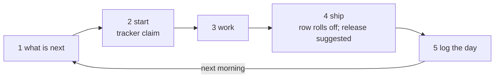
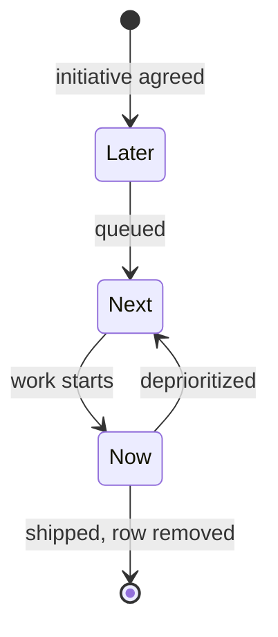
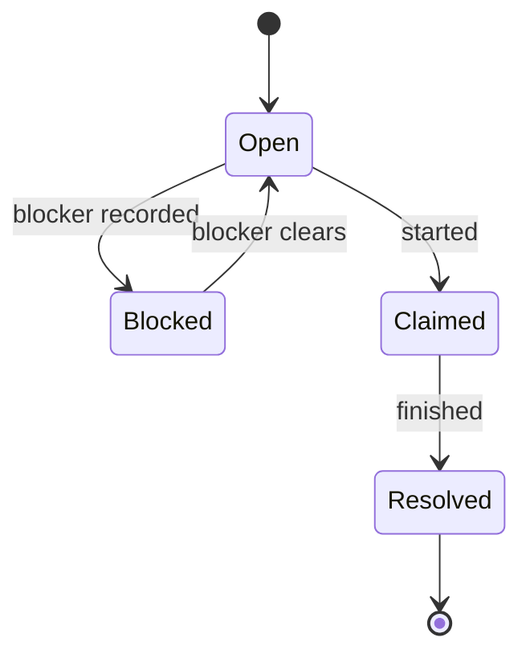

# Project memory skills

Four skills answer four questions about a project's files. You ask in plain words, and the agent picks the skill. Say the skill's name when you want it directly.

A fifth skill, `my-name-pane`, labels the tmux pane after the work the session took on: a roadmap row, a spec, or the session goal. It owns no file.

The terms _initiative_, _horizon_, and _release_ are defined in [GLOSSARY.md](../GLOSSARY.md).

The routing rule lives in [`global/skills/my-project-memory-setup/project-memory.md`](../global/skills/my-project-memory-setup/project-memory.md). The `my-project-memory-setup` skill appends it to a project's `AGENTS.md` or `CLAUDE.md`. This page explains the loop to a person; the rule says what to do and when.

| You ask                                       | Skill                     | File it owns                         |
| --------------------------------------------- | ------------------------- | ------------------------------------ |
| Where are we? What is next? What is blocked?  | `my-status`               | `STATUS.md`, a view over the tracker |
| Log the day, read it back, or find a decision | `my-worklog`              | `WORKLOG.md`                         |
| Update the roadmap, add or move an initiative | `my-roadmap-management`   | `ROADMAP.md`                         |
| Add a changelog entry, cut a release          | `my-changelog-management` | `CHANGELOG.md`                       |

## The split

Three artifacts, three jobs:

- **The roadmap** holds the investment decision: which initiatives we are funding, over a rolling horizon.
- **The tracker** holds execution: specs, tickets, blocking edges, and triage state. A local-markdown tracker keeps them under `.scratch/<slug>/`; a GitHub-issue tracker keeps them in issues.
- **The changelog** holds the release record: what each release changed for users and operators.

A fact lives in one place. The roadmap and changelog link to the tracker; they do not copy it.

## A normal day

1. **Start with "what is next".** `my-status` prints every open, unblocked, unclaimed ticket in `Next`, each with a link. Nothing is trimmed. You pick the work.
2. **Mark the item started.** The tracker records the claim; the status view reflects it. For a roadmap initiative, the row is already under `Now`, or you move it there.
3. **Work.** Mid-flight changes go to the tracker: a reframe, a split, a new spec. The roadmap row changes only when the initiative itself changes.
4. **Ship.** The change lands on main. If it completes a roadmap initiative, remove the row and suggest a release. The changelog records what users and operators get.
5. **End with "log the day".** `my-worklog` appends today's heading and the session's bullets. A `Decision:` line records a choice and its reason. A `Handoff:` line names what the next session should pick up.
6. **Next morning**, "where are we" shows the status view, its age, and what waits on what. The worklog holds yesterday's reasoning.

The day is a loop. "Next morning" returns to the first step.



## What each file holds

- **`STATUS.md`** is a view, not a record. It holds one sentence of present state, then active work, blockers, and the unblocked frontier. Every line links to the tracker item or doc that explains it. Delete it and the tracker can rebuild it. The `Updated:` date tells you when it was last rendered.
- **`WORKLOG.md`** is the narrative, one heading per day, newest last. It is append-only, so earlier days stay as written. It holds what you did, the decisions, and the handoffs.
- **`ROADMAP.md`** is the forward index of initiatives over `Now`, `Next`, and `Later`. A row is one initiative: what changes for the user, and a link to its spec. Confidence is an optional note. A shipped initiative rolls off; the changelog is its record. The tracker owns blocking edges.
- **`CHANGELOG.md`** is the backward record of releases. A release is a date-named section, cut by hand. Entries are generated from Conventional Commits and then edited into user language. Internal work gets no entry.

## The roadmap row and the tracker item

The roadmap row and the tracker item move on different clocks. The roadmap orders investment; the tracker records execution. Their present tense agrees: a row is `Now` while its ticket is `Active`.

### Roadmap row



A row enters after you agree to the initiative. The horizon is the schedule; there is no promotion ceremony. When the initiative ships, the row leaves. The changelog records the release when one is cut.

### Tracker item



The tracker owns this lifecycle. `my-status` renders it; it does not change it.

## Where does this go?

- A refactor, test, lint pass, or internal doc note → the worklog.
- A user-visible fix, a changed default, or a deploy change such as an env var or port → the changelog.
- A removed feature → the changelog `### Removed` entry.
- A whole initiative → a roadmap row linking its spec, plus a changelog entry when it ships.
- A decision → the worklog `Decision:` line, with a link to the doc that argues it.
- A blocked item → the tracker's `Blocked by` line, reflected under `Blocked` in the status view.
- A started or finished item → the tracker, reflected under `Active` or removed from the view.

## Adopting the skills in a project

The skills are global; the routing rule is opt-in. They work in any repo, with a local-markdown tracker or GitHub issues.

1. **Run `my-project-memory-setup` in the project root.** It appends the routing rule to `CLAUDE.md` or `AGENTS.md`.
2. **Run "where are we".** When no status file exists, the agent answers from the tracker and offers to create `STATUS.md`. Accept, or ask for the first edit.
3. **Log the first day.** "Log the day" writes today's heading and the session's bullets.
4. **Keep the defaults or declare your own.** Put the paths in `AGENTS.md` or `CLAUDE.md` when they differ:

   ```markdown
   ## Workflow files

   - Status: `docs/STATUS.md`
   - Worklog: `docs/WORKLOG.md`
   - Roadmap: `ROADMAP.md`
   - Changelog: `CHANGELOG.md`
   ```

5. **Name the tracker when it is not obvious.** A local-markdown tracker keeps specs and issues under `.scratch/<slug>/`. A GitHub-issue tracker uses `gh issue list`. The agent asks when the repo shows neither.

A project that already keeps a status file, worklog, roadmap, or changelog under another name keeps it. The skills reuse that file and its shape, and never create a second one.

## Habits that keep the files useful

- Ask the skill instead of editing the files by hand, so the shape stays consistent.
- Keep `STATUS.md` lines as links. A copied fact goes stale in one of its two homes.
- Keep roadmap rows on initiatives. A ticket belongs in the tracker.
- Log the day before you stop. A handoff written tomorrow loses the detail you had today.
- Cut a release when you want to report what changed. The date is the version.
