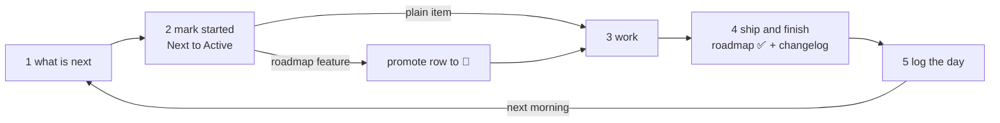
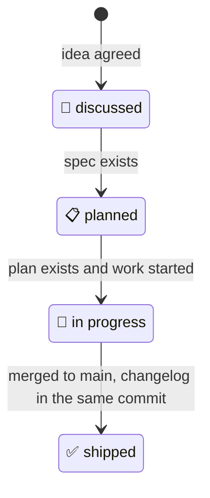
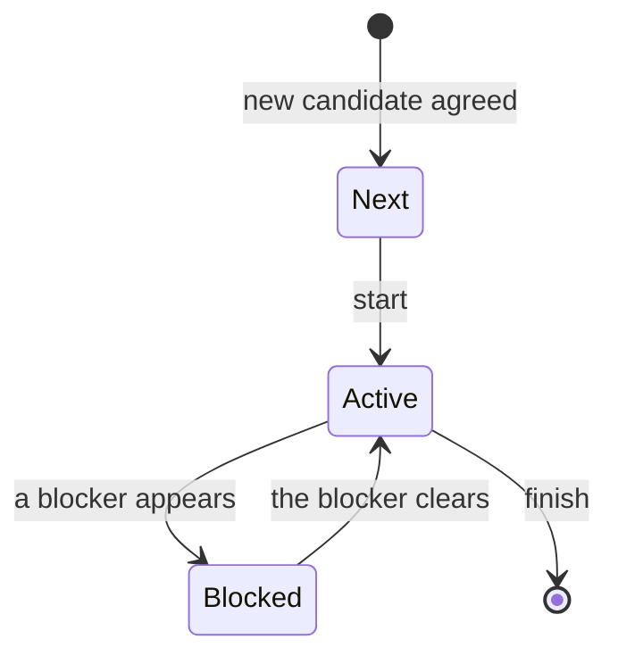

# Workflow skills

Four skills answer four questions about a project's files. You ask in plain words, and the agent picks the skill. Say the skill's name when you want it directly. A fifth skill, `my-name-pane`, labels the tmux pane after the row you picked and owns no file.

| You ask | Skill | File it owns |
|---|---|---|
| Where are we? What is next? What is blocked? | `my-status` | `STATUS.md` |
| Log the day, or read it back | `my-worklog` | `WORKLOG.md` |
| Update the roadmap, mark a feature shipped | `my-roadmap-management` | `ROADMAP.md` |
| Add a changelog entry for a change with no roadmap row | `my-changelog-management` | `CHANGELOG.md` |

## A normal day

1. **Start with "what is next".** `my-status` prints the `Next` section with a link for each item. When `Next` is empty, it lists the open tracker items, from `.scratch/<slug>/` or GitHub issues. You pick the work.
2. **Mark the item started**: say "move X to active". `my-status` moves it from `Next` to `Active`. For a roadmap feature, also promote its row `📋 → 🚧` once the plan exists and work has started. `Active` and `🚧` track the same work: a status line and a roadmap row.
3. **Work.** Mid-flight changes go to the roadmap: a reframe, a split, or a new spec link. The agent commits only when you ask, so say when you want one.
4. **Ship and finish.** "Mark X shipped" moves the roadmap row to `✅` and writes the changelog entry in the same commit. "Finish X" deletes the item from `Active`. The two edits close the same piece of work.
5. **End with "log the day".** `my-worklog` appends today's heading and the session's bullets. A `Decision:` line records a choice and its reason. A `Handoff:` line names what the next session should pick up.
6. **Next morning**, "where are we" shows the status file, its age, and what waits on what. The worklog holds yesterday's reasoning.

The day is a loop. "Next morning" returns to the first step.



## What each file holds

- **`STATUS.md`** is an index, not a record. It holds one sentence of present state, then active work, blockers, and hand-picked next items. Every line links to the tracker item or doc that explains it. The `Updated:` date tells you how fresh the file is.
- **`WORKLOG.md`** is the narrative, one heading per day, newest last. It is append-only, so earlier days stay as written. It holds what you did, the decisions, and the handoffs.
- **`ROADMAP.md`** is the forward view of features, from 💭 to ✅. A row earns `💭` on agreement, `📋` with its spec, and `🚧` with its plan and started work. A row is short and links to its spec and plan. Dependencies show up as order, not as a graph.
- **`CHANGELOG.md`** is the backward view of what reached the main branch. It records contract and behaviour changes for users and operators. Internal work gets no entry.

## The two lifecycles

The roadmap row and the status item each pass through a fixed set of states. A state diagram shows every state, its allowed moves, and the condition for each move.

### Roadmap row



A row enters at `💭` only after you agree to the idea. Each later move needs its linked document, or the merge for `✅`.

### Status item



`Next` and `Active` are the two live states. `Blocked` is a detour back to `Active`. Finishing deletes the line, because the tracker and worklog keep the record.

## Where does this go?

- A refactor, test, lint pass, or internal doc note → the worklog.
- A user-visible fix, a changed default, or a deploy change such as an env var or port → the changelog.
- A removed feature → the changelog `### Removed` entry. The `✅` roadmap row stays.
- A whole feature → the roadmap, plus the changelog when it ships. Route a shipment through `my-roadmap-management`, so both files change in one commit. A changelog entry alone is for changes with no roadmap row.
- A decision → the worklog `Decision:` line, with a link to the doc that argues it.
- A blocked item → `STATUS.md` under `Blocked`, naming what it waits for.
- A started or finished item → `STATUS.md`, moved to `Active` or deleted.

## Adopting the skills in a project

Nothing to install; the skills are global. They work in any repo, with a local-markdown tracker or GitHub issues.

1. **Run "where are we" in the project.** When no status file exists, the agent answers from the tracker and offers to create `STATUS.md`. Accept, or ask for the first edit.
2. **Log the first day.** "Log the day" creates `WORKLOG.md` with today's heading.
3. **Keep the defaults or declare your own.** Put the paths in `AGENTS.md` or `CLAUDE.md` when they differ:

   ```markdown
   ## Workflow files

   - Status: `docs/STATUS.md`
   - Worklog: `docs/WORKLOG.md`
   - Roadmap: `ROADMAP.md`
   - Changelog: `CHANGELOG.md`
   ```

4. **Name the tracker when it is not obvious.** A local-markdown tracker keeps specs and issues under `.scratch/<slug>/`. A GitHub-issue tracker uses `gh issue list`. The agent asks when the repo shows neither.

A project that already keeps a status file, worklog, roadmap, or changelog under another name keeps it. The skills reuse that file and its shape, and never create a second one.

## Habits that keep the files useful

- Ask the skill instead of editing the files by hand, so the shape stays consistent.
- Keep `STATUS.md` lines as links. A copied fact goes stale in one of its two homes.
- Log the day before you stop. A handoff written tomorrow loses the detail you had today.
- Bump `Updated:` whenever you touch the status file.
- Promote a roadmap row to ✅ only after the change has landed on the main branch.
